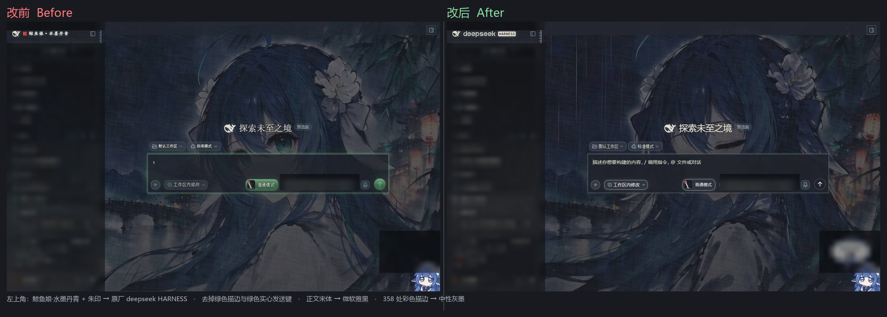
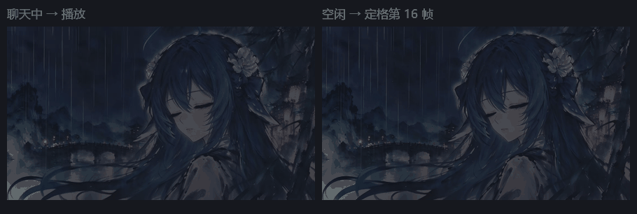
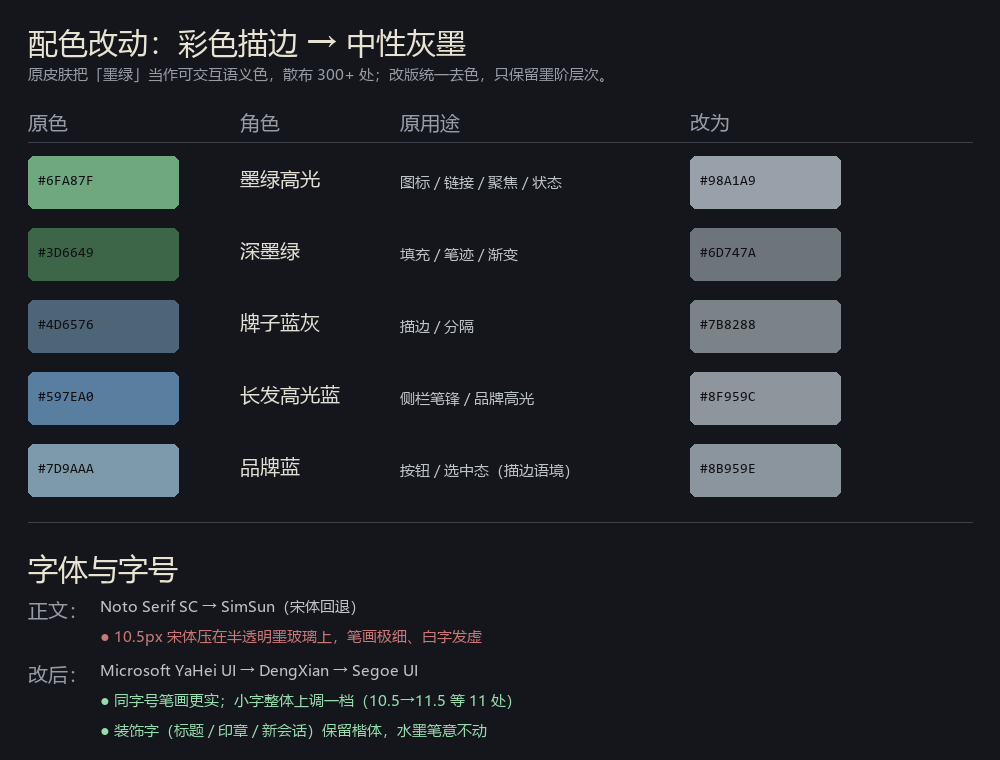

# 鲸鱼娘 · 水墨丹青（清晰版）

**Whale Girl · Ink Wash (Readable)** — DSH 皮肤（基于原作者皮肤的**可读性改版**）



> **只想赶紧装？** 跳到 [📦 安装](#-安装)，
> 或者直接复制 [🤖 让 AI 帮你装](#-懒得动手让-ai-帮你装) 里的提示词。

---

> **这是改版（fork），不是原作。**
> 原皮肤《鲸鱼娘 · 水墨丹青》由 **stushansusu** 创作、经 [DSH Market](https://dsh-market.com) 发布，
> 采用 **CC BY-NC-SA 4.0**。本仓库是 **Akina2566** 的可读性改版，同样以 CC BY-NC-SA 4.0 分享。
> 美术素材版权归原作者，详见 [ATTRIBUTION.md](ATTRIBUTION.md)。

## 我改了什么、为什么改

原皮肤很好看，但**作为每天要看几小时中文长文的界面**，有五处顶不住：

| # | 改前的问题 | 我改成了什么 | 为什么 |
|---|---|---|---|
| 1 | 背景视频**永远在播**（25 秒循环），读消息、打字时都在动 | **聊天时才播放，空闲时定格在画面最好的一帧** | 持续运动抢注意力；白字压在流动画面上更累 |
| 2 | 正文落到 **SimSun（宋体）**，10.5px 压在半透明玻璃上 | 正文改 **微软雅黑**，小字整体上调一档 | 宋体小字笔画极细，暗底上发虚；雅黑同字号更实 |
| 3 | **358 处**墨绿 / 蓝灰彩色描边（按钮、边框、图标、进度条） | 统一成**中性灰墨**，只保留墨阶层次 | 满屏彩色描边让主次不清，也压掉了「墨分五色」的高级感 |
| 4 | 左上角被换成「鲸鱼娘·水墨丹青」+ 朱印 | 恢复**原厂 deepseek HARNESS** 字标 | 遮挡厂商标识；且每次看到都在提醒「这是皮肤」 |
| 5 | 侧栏不透明度只有 **54%**，背后 4K 画面透上来 | 面板压到 **85–90%** | 文字与画面互相干扰，长文阅读很累 |

顺带还有两处小修：暗色模式次要文字提亮（6 个 token，覆盖时间戳/占位符）、文字柔光从三层收到两层（去掉字缘那圈「糊」的晕）。

**装饰性的东西一点没动**：楷体标题、印章、笔锋、墨点、纸纹、朱印（品牌行那方除外）全部保留，所以水墨的味道还在，只是**正文能看清了**。

> 动画改动需要配合插件才能生效，原理与实现见 [🎬 动画改进](#-动画改进从一直在动到聊天时才动) 章节。

---

## 📦 安装

> **只有一个安装方式：跑一键脚本。**
> 它会把皮肤和动画插件一起装好 —— 因为这个皮肤的灵魂（聊天时才动、空闲定格）由插件实现，
> 单独放个皮肤文件夹是没有这个效果的。

---

### 一键安装

先确认 DSH 装过「皮肤中心」插件（**设置 → 皮肤中心** 能打开）。
如果没有，见本文末尾的 [前置依赖](#前置依赖皮肤中心不是-dsh-自带的) 一节。

**Windows**（在仓库目录里，右键 → 在终端中打开）：

```powershell
powershell -ExecutionPolicy Bypass -File .\install.ps1
```

**macOS / Linux**：

```bash
bash install.sh
```

脚本会做完这些事，并打印每一步结果：

1. 皮肤 → `~/.dsh/skins/shuimo-danqing-readable/`
2. 插件 → `<profile>/node_modules/dsh-plugin-bg-motion/`
3. 插件挂进 profile 的 `bundles`（**自动备份** `package.json.bak-bgmotion`）

> 脚本只动「已经装了皮肤中心」的那个 profile，不会污染其它 profile。
> 如果你是从 git 克隆的（有 `.git` 目录），插件会用软链接指向仓库，
> 以后 `git pull` 更新后**不用重装**。

**装完 → 完全退出 DSH 再打开 → 设置 → 皮肤中心 → 选「鲸鱼娘 · 水墨丹青（清晰版）」。**

---

### 卸载

1. 皮肤中心里切回别的皮肤
2. 删目录：`rm -rf ~/.dsh/skins/shuimo-danqing-readable`
3. 想连插件一起卸：把 profile 的 `package.json` 恢复成
   `package.json.bak-bgmotion`，再删 `node_modules/dsh-plugin-bg-motion`

---

### 🤖 懒得动手？让 AI 帮你装

把下面这段**整段复制**给 AI（DSH 对话、Claude、ChatGPT 都行）：

```text
帮我在这台电脑上安装一个 DSH（DeepSeek Harness）皮肤，要装全套（含动画插件）。

仓库：https://github.com/Akina2566/shuimo-danqing-readable

请按顺序做，每步先检查再动手：

1. 找到 DSH 配置目录（一般 ~/.dsh，Windows 是 %USERPROFILE%\.dsh）。
   不存在就先让我打开一次 DSH。

2. 检查「皮肤中心」插件是否已装：看 <DSH配置目录>/profiles/<profile>/package.json
   里有没有 @linxin666/dsh-web-all 或 @linxin666/dsh-client-ui-skin-center。
   没装就告诉我，让我先装（dsh plugin --profile <profile> add @linxin666/dsh-web-all）。

3. 把仓库克隆到临时目录，然后运行仓库里的安装脚本：
   - Windows: powershell -ExecutionPolicy Bypass -File .\install.ps1
   - macOS/Linux: bash install.sh
   这个脚本会自动装皮肤 + 装动画插件 + 挂进 profile。

4. 校验结果：
   - <DSH配置目录>/skins/shuimo-danqing-readable/skin.json 存在
   - <DSH配置目录>/profiles/<profile>/node_modules/dsh-plugin-bg-motion 存在
   - 该 profile 的 package.json 的 dsh.profile.bundles 里有 dsh-plugin-bg-motion

5. 告诉我要重启 DSH，然后在「设置 → 皮肤中心」里选「鲸鱼娘 · 水墨丹青（清晰版）」。
   换完没反应就按 Ctrl+Shift+R 硬刷新。

注意：不要删除 .dsh 里的其它内容，不要改 profile 里无关的插件行；
脚本会自动备份 package.json，改坏了可以还原。
```

---

### 前置依赖：「皮肤中心」不是 DSH 自带的

DSH 装完之后**默认没有皮肤功能** —— 没有皮肤目录、没有皮肤中心界面、也没有 `.dsh/skins`。

这些全部来自第三方插件 **`@linxin666/dsh-client-ui-skin-center`**
（属于 `@linxin666/dsh-web-all` 全家桶，作者 [zhu1090093659](https://github.com/zhu1090093659/dsh-web)）。

| 检查 | 结果 | 怎么办 |
| --- | --- | --- |
| 设置里有「皮肤中心」 | ✅ 已装 | 直接用上面的安装方式 |
| 设置里没有 / 找不到 | ❌ 未装 | 先装插件（见下） |

装插件（任选一种）：

```bash
# 只装皮肤中心本体（推荐，不含任务看板/宠物/远程等其它功能）
dsh plugin --profile web add @linxin666/dsh-client-ui-skin-center

# 或者装全家桶（含皮肤中心 + 一批其它插件）
dsh plugin --profile web add @linxin666/dsh-web-all
```

也可以在 DSH 对话里直接说：「帮我安装插件 `@linxin666/dsh-client-ui-skin-center`」。
装完**重启一次** DSH。

皮肤目录默认位置（插件确定）：

```
~/.dsh/skins/<皮肤id>/
Windows: %USERPROFILE%\.dsh\skins\<皮肤id>\
```

可用环境变量 `DSH_SKINS_HOME` 或 `DSH_SKINS_DIR` 改（优先前者）。

---

## 动画插件（已内置，无需另装）

「聊天时才动」由插件 `dsh-plugin-bg-motion` 实现，它**已经放在本仓库的 `plugin/` 目录里**，
一键安装脚本会自动装好并挂进 profile，你不需要再去别的仓库拿。

它做的事：

- **聊天进行中** → 背景播放完整 25.33 秒视频
- **其余时间** → 定格在第 16 帧（闭眼、有雨丝与花），并压暗到与静帧一致

插件源码位置：`plugin/`（`lib/` 为已构建产物，`src/` 为源码）。
装好后想单独更新它：

```bash
git pull                      # 拉到最新
# 若安装时是复制的（而非软链），重跑一次安装脚本即可同步
```

---

## 🎬 动画改进：从「一直在动」到「聊天时才动」

这是本改版与配套插件带来的**最大体验变化**，也是原始皮肤没有的能力。

### 改前：背景视频永远在播

原皮肤的背景是一段 25.33 秒的循环视频（`video.loop = true; autoplay = true`），由皮肤中心创建。
它从窗口打开那一刻起就一直在播：你读消息时它在动，你在输入框打字时它在动，你切到别的面板它还在动。

问题是：**动态画面会持续抢注意力**。尤其是这段视频开头 16 秒是「白纸落墨」，大片灰白在流动，
白字压在上面本来就吃力，再加上运动，长时间阅读很累。

### 改后：聊天时播放，空闲时定格



| 状态 | 背景行为 |
| --- | --- |
| **聊天进行中**（我在思考 / 输出 / 调工具） | 从 0 秒播放整段 25.33 秒视频，循环 |
| **空闲**（看历史、打字、发呆、切面板） | **完全静止**，定格在第 16 秒那一帧 |

第 16 秒那一帧是特意选的：**闭眼、微低头、雨丝细密**，是这段视频里最安静的一帧。
静止时它就是一张正常的静态壁纸，不会让人觉得「画面卡住了」。

### 怎么判断「在聊天」

难点在于**怎么知道模型正在输出**。壳没有提供统一的“是/否”开关，这里用了三条信号叠加：

1. **壳的标记**：`[data-streaming]`（助手正文正在流式输出）、`[data-running]`
2. **输入框主按钮形态**：运行中发送键会从「箭头」变成「方块（停止）」，用 `aria-label` 和
   图标里是否有 `<rect>` 双重判断
3. **对话区的 DOM 变化频率**：真实输出每秒产生几十次变化，空闲时几乎为零

第 3 条必须**限定在对话区内**。早期版本统计整个页面，结果「点插件按钮」「开菜单」这类操作
也会产生几次变化，被误判成“正在输出”，背景就开始乱动——这个问题已修掉。

另外**打字不算输出**：输入框是 `contenteditable`，每敲一个字都会改 DOM，
所以输入框内的变化被完全排除，否则打字时背景会一亮一暗地闪。

### 为什么静止要用「一张图」而不是「把视频暂停」

最直觉的做法是空闲时 `video.pause()` 然后 `video.currentTime = 16`。实测不行：

- 视频被暂停后**可能不再继续加载数据**，`readyState` 一直停在 0，`currentTime` 设了也不生效
- 就算生效，seek 能否落地还依赖解码头状态，**时好时坏**
- 结果就是：停下时画面可能是**片头的空白宣纸**（视频首尾都是纸），而不是人物

所以改版的做法是：**空闲时盖一张第 16 帧的位图**（`assets/sm-idle-16.webp`，70 KB），
聊天时再露出视频。图是真实文件，不依赖任何 seek 或解码时机，**必然正确**。

### 亮度的坑

视频套上之后有个副作用：**播放时比静止时亮得多**。

原因是我把静止图做成「原帧 + 皮肤 scrim 遮罩」，而视频放的是**原始素材**，没有那层遮罩。
实测同一段画面：静止图亮度 p95 = 72，原始视频 p95 = 205，差了三倍。

试过 `filter: brightness(0.5)`，**无效**——等比缩放会保留亮部，白纸区域依然刺眼。
最后改成：在视频上叠**与 `skin.json` 声明完全相同的那两层渐变 scrim**，这样播放与静止
吃的是同一层遮罩，白字对比度从 1.09:1 恢复到 **10.7:1**。

---

## 我做了哪些改动

> 全部改动都在 **CSS 与资源层**：未改皮肤格式、未引入 JS、未改任何美术素材。

### 1. 字体：宋体 → 微软雅黑

```css
/* skin.css 两处（浅色块 / 暗色块） */
/* 原 */
--dsw-font-family: 'Noto Serif SC', 'Source Han Serif SC', SimSun, 'Microsoft YaHei UI', system-ui, serif;
/* 改 */
--dsw-font-family: 'Microsoft YaHei UI', 'Microsoft YaHei', 'DengXian', 'Segoe UI', system-ui, sans-serif;
```

`patches.css` 的 `--sm-serif` 同步替换。
**`--sm-kai`（楷体）保留**——标题、印章、「新会话」等装饰字仍是水墨笔意，只把正文换成无衬线。

### 2. 小字号整体上调一档（11 处）

| 原 | 改 |
| --- | --- |
| 10.5px | 11.5px |
| 11px | 11.5px |
| 11.5px | 12px |
| 12px | 12.5px |
| 12.5px | 13px |

### 3. 去掉全部彩色描边（改动量最大）



原作把这两支色当作「活口」语义，散落在 300+ 处：

| 原色 | 原用途 | 改为 |
| --- | --- | --- |
| `#6FA87F` 墨绿高光 | 图标、链接、聚焦、状态 | `#98A1A9` |
| `#3D6649` 深墨绿 | 填充、笔迹、渐变 | `#6D747A` |
| `#4D6576` 牌子蓝灰 | 描边、分隔 | `#7B8288` |
| `#597EA0` 长发高光蓝 | 侧栏笔锋、品牌高光 | `#8F959C` |
| `#7D9AAA` 品牌蓝 | 按钮、选中态（仅描边语境） | `#8B959E` |

替换范围与原则：

- `patches.css` / `skin.css` 中绿色系 **171 处**、蓝灰系 **187 处**
- 只替换 **`border` / `border-*` / `outline` / `box-shadow` / 背景装饰** 语境
- 需要保留色相的元素（选中行强调、链接文字）按同一亮度层级降饱和，不整体去色

替换后：全库绿色引用 **0**、彩色描边 **0**。

### 4. 品牌行恢复原厂字标

```css
/* 原 */
body [data-slot='sidebar.brand.name'] > svg { visibility: hidden; }
body span:has(> [data-slot='sidebar.brand.name'])::after { content: '鲸鱼娘·水墨丹青'; /* + 朱印 */ }
/* 改 */
body [data-slot='sidebar.brand.name'] > svg { visibility: visible; }
body span:has(> [data-slot='sidebar.brand.name'])::after { content: none; }
```

左上角回到 **deepseek HARNESS**。

### 5. 暗色模式次要文字提亮（6 个 token）

| token | 原 | 改 |
| --- | --- | --- |
| `--dsw-alias-label-caption` | `#939895` | `#b3b8b4` |
| `--dsw-alias-label-tertiary` | `#939895` | `#b3b8b4` |
| `--dsw-alias-label-dimmed` | `#6a6f71` | `#919692` |
| `--dsw-alias-markdown-placeholder` | `#6a6f71` | `#919692` |
| `--dsw-alias-label-secondary` | `#B8BEB7` | `#cdd2cc` |
| `--dsw-alias-label-primary-dimmed` | `#B8BEB7` | `#cdd2cc` |

### 6. 面板不透明度压实（只动文字承载区）

| 变量 | 原 | 改 | 用在哪 |
| --- | --- | --- | --- |
| `--sm-glass` | `#2227308a`（54%） | `#222730d9`（85%） | 侧栏 |
| `--sm-glass-card` | `#2227309e`（62%） | `#222730e6`（90%） | 输入卡、会话头部、浮层 |
| `--sm-glass-sheet` | `#22273075`（46%） | `#222730c4`（77%） | 次级浮层 |

背景视频、纸纹、笔锋、墨点、朱印（品牌行那方除外）**未改动**，人物仍能透出轮廓。

### 7. 文字柔光减负

会话区与输入卡内的 `text-shadow` 从三层（3/10/24px）收到两层（2/8px），字缘不再有那层「糊」的晕。

### 8. 新增定格帧 `assets/sm-idle-16.webp`

从原背景视频 **第 16 秒**抽帧，并把 `skin.json` 声明的 scrim 渐变烘焙进像素，
作为「空闲时的静止背景」（1920×1080，70 KB）。

---

## 目录结构

```
.
├── skin.json                        # 皮肤清单（id / 名称 / 素材引用）
├── skin.css                         # L1 token 层（官方 --dsw-* 变量重映射）
├── patches.css                      # L3 自由选择器层（机壳规则 + 本改版全部覆盖）
├── assets/
│   ├── shuimo-danqing-loop.mp4      # 背景视频 21.5MB（原作者素材）
│   ├── sm-idle-16.webp              # 定格帧（本改版新增，已烘焙 scrim）
│   ├── sm-paper-grain.webp          # 纸纹（原作者素材）
│   └── sm-paper-grain-strong.webp   # 纸纹强档（原作者素材）
├── preview/
│   ├── dark.jpg                     # 皮肤中心预览图（暗色）
│   └── light.jpg                    # 皮肤中心预览图（浅色）
├── docs/
│   ├── images/                      # README 用的对比图与动图
│   │   ├── before-after.png         # 改前 / 改后整界面对比
│   │   ├── animation-idle-vs-play.gif  # 空闲定格 vs 聊天时播放
│   │   ├── docs-colors.png          # 配色改动对照表
│   │   └── frame-16.jpg             # 第 16 帧原图
│   ├── ORIGINAL-README.zh.md        # 原作完整设计文档（中文）
│   ├── ORIGINAL-README.md           # 原作完整设计文档（英文）
│   └── README.en.md                 # 本文件英文版
├── plugin/                          # 动画插件（已内置，安装脚本自动挂载）
│   ├── lib/                         # 已构建产物（client.js / index.js）
│   ├── src/                         # 源码
│   ├── cordis.patch.yml             # 插件行声明
│   └── package.json
├── install.ps1                      # 一键安装（Windows）
├── install.sh                       # 一键安装（macOS / Linux）
├── ATTRIBUTION.md                   # 归属与来源
├── LICENSE                          # CC BY-NC-SA 4.0
└── README.md                        # 本文件
```

---

## 常见问题

**Q：皮肤中心里看不到这个皮肤？**
A：三件事逐一排查 ——
① 目录名必须是 `shuimo-danqing-readable`（与 `skin.json` 的 `id` 一致）；
② `skin.json` 必须在目录**根层**，不能套两层文件夹；
③ 重启一次 DSH，让皮肤中心重新扫目录。

**Q：换了皮肤但字体没变？**
A：浏览器缓存了旧 CSS。按 `Ctrl+Shift+R` 硬刷新。

**Q：背景视频太大，能不下载吗？**
A：可以。删掉 `assets/shuimo-danqing-loop.mp4`，再把 `skin.json` 里
`contributes.backgroundMedia` 的 `type` 从 `video` 改成 `image`、`src` 指向
`assets/sm-idle-16.webp`。这样仓库只剩几百 KB。

**Q：浅色模式能用吗？**
A：**不能**，本皮肤是 `dark-only`（manifest 里已标记），浅色下配色未适配。

**Q：会被 DSH Market 更新覆盖吗？**
A：不会。目录里没有 `dsh-market.provenance.json`，皮肤中心把它当**本地皮肤**，
不参与市场更新。

---

## 许可与归属

| 项 | 说明 |
| --- | --- |
| **原作** | 《鲸鱼娘 · 水墨丹青》 by **stushansusu** |
| **原作发布** | [DSH Market](https://dsh-market.com)（非官方作品，与本仓库无隶属关系） |
| **原作许可** | **CC BY-NC-SA 4.0** |
| **本改版** | 由 **Akina2566** 修改，同样以 **CC BY-NC-SA 4.0** 分享 |

按 CC BY-NC-SA 4.0 的三项要求：

- **署名 BY**：保留原作者署名，并在本 README、`skin.json` 的 `author` 字段中注明
- **非商业 NC**：不得用于商业用途
- **相同方式共享 SA**：本改版同样以 CC BY-NC-SA 4.0 发布

**美术素材**（背景视频、纸纹、角色立绘）版权归原作者，不在本改版改动范围内，
仅按原许可条款随皮肤分发。详见 [ATTRIBUTION.md](ATTRIBUTION.md)。
若原作者认为本仓库有不妥之处，联系后立即下架。

---

## 变更记录

### v1.0.0-readable

- 正文/UI 字体换为微软雅黑，装饰字保留楷体
- 小字号上调一档（11 处）
- 去除全部墨绿与牌子蓝彩色描边（358 处色值），统一中性灰墨
- 品牌行恢复原厂字标，移除朱印
- 暗色模式次要文字提亮（6 个 token）
- 面板不透明度压实（3 个变量）
- 文字柔光从三层收到两层
- 新增定格帧 `assets/sm-idle-16.webp`

---

## 相关

- 皮肤格式与皮肤中心：[zhu1090093659/dsh-web](https://github.com/zhu1090093659/dsh-web)
- 配套插件（背景动效闸门）：[dsh-plugin-bg-motion](https://github.com/Akina2566/dsh-plugin-bg-motion)
